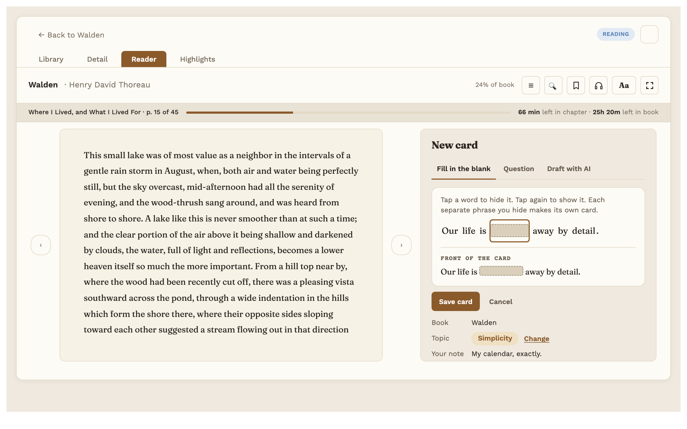
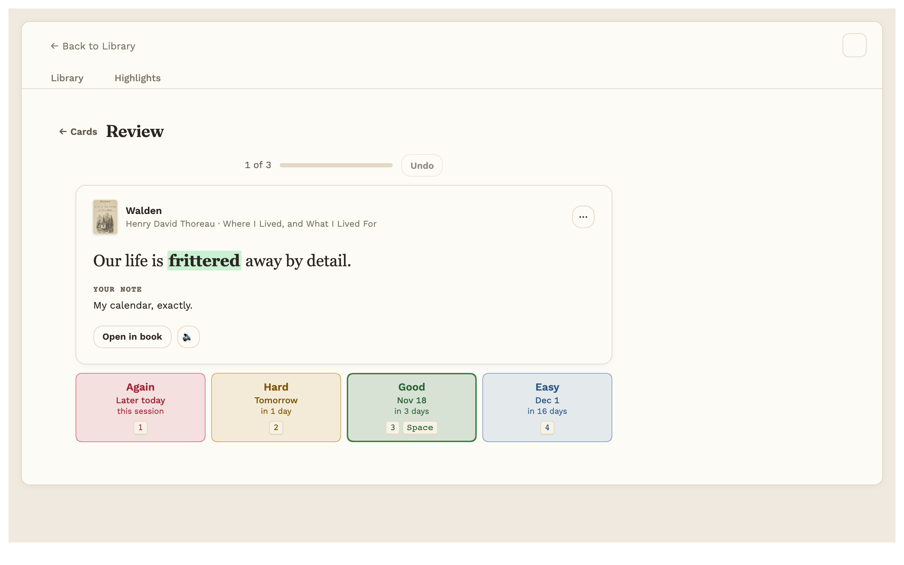

# Flashcards

**Free and Pro.** Your first 20 cards are free. Pro removes the limit and adds a few extras. The split is at the bottom of this page.

A flashcard turns a highlight into a small question you answer later. Reading Vault shows each card again just before you would forget it, so the idea sticks. You do a few cards a day, and it takes a couple of minutes.

## Make a card

Press **Make card** next to a highlight. You'll find it:

- In the pop-up that opens when you click a highlight in the Reader. If you have just selected new text, it is saved as a highlight first.
- Beside each highlight on a book's page.
- Beside each highlight in the **Highlights** tab.
- In [Highlight review](highlight-review.md).

The card maker opens beside the page in the Reader, and as its own screen everywhere else. It has two kinds of card:

- **Fill in the blank.** Tap the words you want to hide, and tap again to show them. Words that touch become one blank. Each separate phrase you hide makes its own card.
- **Question.** Write your own question. The answer starts as the passage, or press **Use the whole passage** to keep it that way.



The book, the chapter and the Topic come from the highlight. You can change the Topic. Press **Save card**. You'll see "Card saved. First review tomorrow." with an **Undo** button.

The card maker stays open on the same passage, titled **Another card from this passage**, so you can make as many cards from one highlight as you like: hide other words, or switch to **Question**. You can also press **Make card** on the same highlight again later.

Each card is a note in a **Cards** folder inside your Reading folder, so it stays yours. Reading Vault keeps that folder out of Obsidian's search and graph. Renaming a book or moving folders in Settings keeps your cards linked.

### Missed it in Highlight review

With Pro, if you press **Sooner** on a highlight in [Highlight review](highlight-review.md) while **Remember first** is on, you'll see "Did not remember it?" and a **Make card** button. Save the card and you go straight on to the next highlight.

### Word cards (Pro)

For words you saved in [Word lookup](word-lookup.md), English only:

- On a book's page, press **Make cards for these words** under its saved words. **Both ways** is on by default: word to meaning, and meaning to word.
- On a word's look-up card, press **Make card** after **Save word**. Saving a word never makes a card on its own.

Each card leads with the word's base form and keeps the sentence from your book. Words that already have cards are skipped.

## Review your cards

Press **Review cards** from the command palette, or press "N cards due" in the Today line at the bottom of the Library. The [Reading Dashboard](reading-dashboard.md) has a Cards box too.

The first screen shows how many cards are due today, about how many minutes that takes, and how they split into new, to review and tomorrow. Choose **All cards**, one book or one Topic, then press **Start**. If more than 5 are due, **Just 5 cards** gives you a short session.



For each card:

1. Read the front. A blank looks like a dashed box.
2. Press **Show answer** (or the Space key).
3. Say how well you remembered it: **Again**, **Hard**, **Good** or **Easy**. Each button shows the date the card will come back. Keys 1 to 4 work too, and Space means Good.

**Again** brings the card back at the end of this session. Press **Undo** (or Z) to take back your last answer.

Under the card, **Open in book** jumps to the highlight, the Topic button opens the Topic note, and the speaker button reads the card aloud (Pro). The **⋯** menu has:

- **Edit card**
- **Skip for now.** It comes back at the end.
- **Pause this card.** It stays out of your reviews until you resume it.
- **Delete card…** It asks first, and then offers **Undo**. The highlight stays in your book.

## Where cards show up

With Pro, you don't have to open Reading Vault to see your cards. In Settings, under **Flashcards**, the **Where cards show up** group has seven places, all off to begin with. Without Pro, you review your cards in Reading Vault itself, and a card box already in a note says it is part of Pro.

1. **Cards inside your notes.** Put this in any note:

   ````
   ```reading-vault-cards
   ```
   ````

   It shows the next due card. Press **Show answer**, then **Again**, **Hard**, **Good** or **Easy**, and the next card comes up, on the same schedule as the full review. **Add to daily note** adds it to the end of the template set in Obsidian's Daily notes settings, once.
2. **Due cards table.** **Make the table** makes "Due cards.base" in your Cards folder, a table of the cards due today or earlier. It is for browsing; you rate cards in the review. While the table exists, each card note gets the Due property.
3. **Message when Obsidian opens.** "5 cards due today" with a **Review** button. Off to begin with.
4. **Open the review when Obsidian opens.** Off to begin with.
5. **Cards in the side panel.** The same card box, beside your notes.
6. **Count in the bottom bar.** "5 cards due" at the bottom of the window; click it to review. Computers only.
7. **Review link.** **Copy link** copies `obsidian://reading-vault-cards`. Put it in a phone reminder or a calendar event; tapping it opens today's review.

The message and the review when Obsidian opens come at most once a day, and only when cards are due. A card you rate in one place is done in all the others.

## The daily schedule and limits

Reading Vault uses a smart schedule: cards you know well come back less often, and cards you forget come back sooner.

Each day you get up to 10 new cards and 100 reviews. Change both under Settings, then **Flashcards** (or press **Change** on the first screen).

When you finish, **Done for today** shows how many cards you did, how many minutes it took, how many you remembered (Hard, Good or Easy) and forgot (Again), what is due tomorrow, and your streak ("N days in a row"). A day with nothing due does not break your streak.

If the limit held some cards back, you'll see "N more cards were due today but are over your daily limit". They wait for tomorrow, or press **Keep going** to do them now. With Pro, **Reread N highlights** takes you to Highlight review when some are waiting.

## The card list

On the first screen, pick a book or a Topic and press **See all N**. The list is free for everyone. You can:

- Search as you type.
- Filter by **All**, **Due today**, **New** or **Paused**.
- See each card's front, its kind, its Topic, and when it comes back (or **Paused**).
- **Edit** a card, **Pause** or **Resume** it, or **Delete…** it.
- Tick several cards to pause or delete them together. Deleting asks first, then offers **Undo**.

A book's list also says "N highlights in this book have no card yet", with **Make cards** to go and add them. **Review N due** and **Practice all** sit at the top.

## Practice all (Pro)

**Practice all** goes through every card in a book or Topic right now, however far off the next date is. It is good before an exam. Press **Again** or **Got it** on each card. Practice never changes your schedule and saves nothing.

At the end, **Practice finished** shows how many cards you got right the first time and how many you missed. **Go over the N missed** repeats the missed ones until none are left.

## Draft with AI (Pro)

In the card maker, the **Draft with AI** tab asks your AI service for two drafts from the passage and your note on it: a question and a fill in the blank. Nothing is sent until you press **Draft two cards**.

For each draft, press **Keep**, **Edit** or **Throw away** (with **Undo**). **Save** stays gray, with "Keep at least one draft to save it.", until you keep one. The cost is shown: about $0.002, charged to your own AI key.

It uses the same key as [Ask the book](ask-the-book.md). With no key, you'll see a screen with **Set up in Settings** and **Write the card myself**. With no internet it says "Needs internet".

## Export to Anki

Anki is a free flashcard app. To take your cards there, press **Export cards for Anki** in the command palette, or **Export…** in Settings under Flashcards. Choose all cards, one book or one Topic, and press **Export**. This is free for everyone, and it still works if you stop using Pro.

The file is saved in the Exports folder inside your Reading folder. On a phone, **Share…** sends it on. In Anki (version 2.1.54 or newer), choose File, then Import. Cards land in decks named "Reading Vault::" and the book's title, with the book, chapter and Topic as tags.

Anki starts these cards fresh: your review history does not travel in this file yet.

## Free and Pro

**Free:**

- Your first 20 cards from highlights, as fill in the blank or question. "N of 20 free cards used" shows under **Save card**. Deleting a card frees its place.
- Reviewing them, the card list, pausing, editing and deleting, your streak and **Undo**.
- **Export cards for Anki**, always, even if you never buy Pro.

When you reach card 21, you'll see "Your 20 free cards are made" with **Get Pro**, **Export to Anki** and **Not now**. Your 20 cards keep working.

**Pro:**

- As many cards as you like.
- Word cards.
- Draft with AI.
- Practice all.
- Read aloud.
- Cards from missed answers in Highlight review.
- [Where cards show up](#where-cards-show-up): cards inside your notes, the Due cards table, the message or review when Obsidian opens, the side panel, the bottom bar count and the review link.
- Flashcards on your [iPhone or iPad](phone.md), which needs Pro.

Cards you made while you had Pro stay reviewable if Pro ends.

See [Reading Vault Pro](reading-vault-pro.md) to get Pro.
