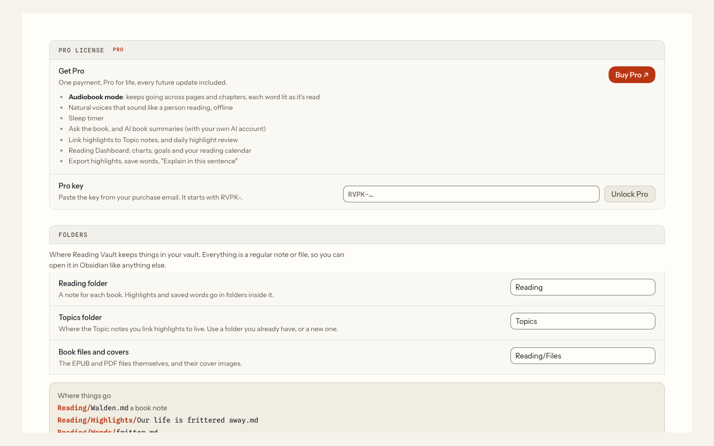

# Reading Vault Pro

**Pro.** This page is about Pro itself.

Pro is a one-time payment. You get every Pro feature for life, including every future update. There's no subscription.

## What Pro adds

- [Audiobook mode](audiobook-mode.md): listening keeps going across pages and chapters, each word lights up as it's read, and a sleep timer
- [Natural offline voices](natural-voices.md)
- [Linking highlights to Topic notes](topic-links.md)
- [Highlight review](highlight-review.md)
- [Ask the book](ask-the-book.md)
- [AI book summary](book-summary.md)
- [Reading Dashboard](reading-dashboard.md)
- [Saving words](saved-words.md), and "Explain in this sentence" in [Word lookup](word-lookup.md)
- [Export highlights](export.md)
- [Reading Vault on your iPhone or iPad](phone.md): on a phone or tablet, Reading Vault needs Pro, and the same license unlocks it

Everything else in this manual is free.

## Get Pro

1. Go to Settings, then Reading Vault. **Pro license** is at the top.
2. Under **Get Pro**, press **Buy Pro ↗**. This opens my store, Workbench Goods, on Payhip.
3. After you pay, you'll get an email with your Pro key.

## Unlock Pro

Unlock Pro on your computer. Your iPhone or iPad picks the key up with your vault, so you only do this once (see [Reading Vault on your iPhone or iPad](phone.md)).

1. Copy the key from your purchase email. It starts with **RVPK-**.
2. Paste it into the **Pro key** box.
3. Press **Unlock Pro**.

The section then says **Pro is unlocked**, with your key's number, for example "Pro key #1042".

Your key is checked on your own computer or phone. It never goes online, and it never expires.

If a key doesn't work, a short message says why. Check you copied the whole key. If it still doesn't work, email me at jhesch@gmail.com (the message shows the same address).

## Moving to a new computer or phone

Your key works on your next computer or phone too. If it doesn't come across with your vault, paste the same key again.

**Remove key** (in the Pro license section, it asks you to confirm) takes the key out of the vault's plugin settings. Only use it on a device that no longer shares the vault: on a synced vault it turns Pro off on your other devices too.

## Good to know

- Pro works on your computer and on an iPhone or iPad (iOS 17 or newer), with one license. On the phone, listening uses the phone's own built-in voices; the natural voices are computer only. Tested on Mac and iPhone; Windows is untested. Android isn't supported yet.
- If you remove your key, your notes, highlights and saved words all stay in your vault.
